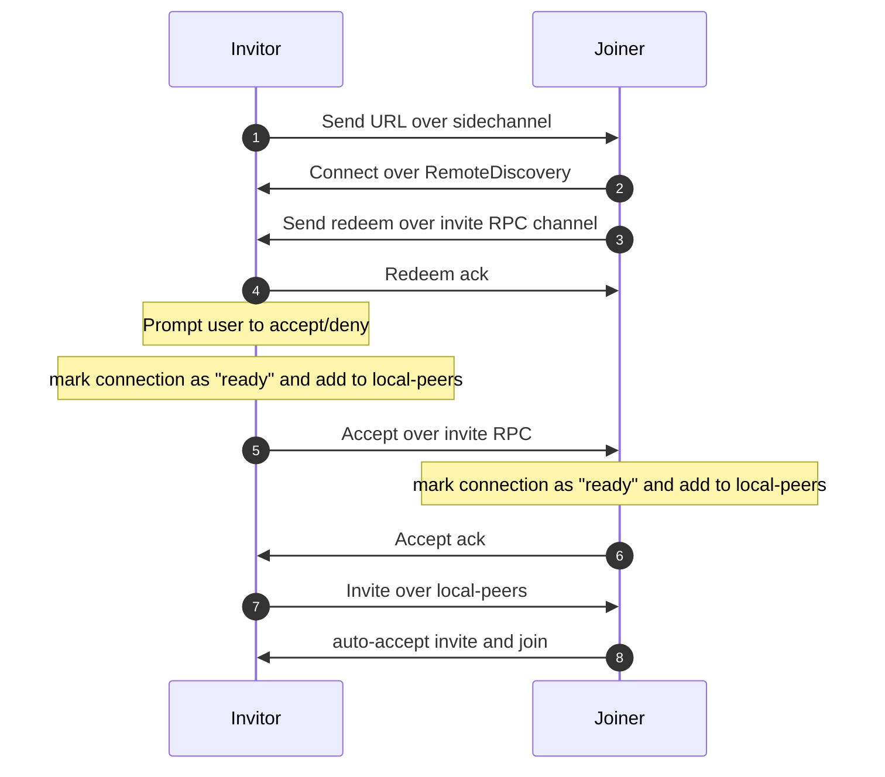

# Inviting New Members Over the Internet

## Concepts

## Steps

- Invitor: Set up project
- Invitor: create invite link
- Invitor: send link out of bounds
- Invitor: wait for `invite-link-join-request`
- Invitee: get Invitor name and project name from the link
- Invitee: use invite link to connect and join
  - Creates a join request and listens to `join-request-update` events for progress
  - On `completed` the join request contains the resolved project ID
  - On `failed` the join request's `error` is the error `code` (a string), and a
    `join-request-error` event is emitted with the full `KnownError` carrying the
    `inviteId` (use the event when you need `.message` / `.cause`)
  - Finished (`failed`/`completed`) join requests stay in the list (visible via
    `getJoinRequests` / `getJoinRequestById`). An in-flight request for the same
    invite ID throws `ExistingJoinRequestError`; re-clicking a link whose previous
    attempt finished replaces that entry with a fresh attempt
- Invitor: Get `invite-link-join-request`
- Invitor: Accept invite link request which sends them an invite and follows the usual flow
- **OR** Invitor: Deny invite link request which disconnects and errors them out

## Examples

## Invitor Flow

```JavaScript
// name is the invitee's device name, sent with the redeem message
manager.on('invite-link-join-request', async (projectId, deviceId, inviteId, name) => {
  const project = await manager.getProject(projectId)

  // Reason is same as from invite api
  // Throws if there is an error during the invite proces
  const reason = await project.$member.acceptInviteLinkRequest(inviteId, deviceId)
  // InviteNotYetRedeemedError
  // UnknownInviteIDError
  // PeerDisconnectedSinceRedeemingInviteError
  // InviteAbortedError

  // You can also deny the request
  await project.$member.denyInviteLinkRequest(inviteId, deviceId)
})

// creat a new invite link
const url = await project.$member.createInviteLink({
  roleId: MEMBER_ROLE_ID,
})
// InvalidProjectNameError

// cancel at any time
await project.$member.cancelInviteLink(inviteId)
// InvalidInternetInviteURLError

// get curren list
const [{
  url,
  inviteId,
  roleId,
  createdAt,
  expiresAt,
}] = await project.$member.listInviteLinks()
```

## Invitee Flow

```JavaScript
import {parseInviteURL} from '@comapeo/core/invite-urls.js'

const {
	invitorName,
	projectName,
	expiresAt,
	inviteIdString,
	roleId,
} = parseInviteURL(url)

// Listen for join progress updates
// update.status: 'connecting' | 'connected' | 'accepted' | 'completed' | 'failed'
// update.projectId is set on 'completed'
// update.inviteId can be used to differantiat between concurrent invites
// update.url is te original URL
// update.error is the error code (string), set on 'failed'
manager.inviteLinks.on('join-request-update', (update) => {
  switch (update.status) {
    case 'connecting':
      // Showing "waiting to connect" screen
      break
    case 'connected':
      // Connected to the invitor and waiting for accept/deny
      // Show "waiting for accept" screen
      break
    case 'accepted':
      // Invitor has accepted, initial sync in progress
      // Show "joining project" screen
      break
    case 'completed':
      // Join succeeded — update.projectId has the project public ID
      break
    case 'failed':
      // Join failed — update.error has the error code (e.g. 'CONNECTION_LOST_ERROR')
      // Subscribe to 'join-request-error' for the full KnownError and its .cause
      break
  }
})

// Failed joins are also reported as a dedicated `join-request-error` event.
// The error is a KnownError carrying the inviteId, so you can tell concurrent
// join requests apart (and subscribe to errors without the update stream):
manager.inviteLinks.on('join-request-error', (error) => {
  // error.inviteId — which join request failed
  // error.code / error.status — machine-readable reason
})

// Start the join (fire-and-forget, returns a JoinRequest synchronously)
const {
  inviteId,
  swarmPublicKey,
  url: originalUrl,
  status,     // 'connecting' | 'connected' | 'accepted' | 'completed' | 'failed'
  error,      // string | null — error code, set on 'failed'
  projectId,  // string | undefined — set on 'completed'
} = manager.inviteLinks.createJoinRequest(url)
// ExistingJoinRequestError — an in-flight request already exists for this invite ID
// A finished (failed/completed) request for the same invite ID is replaced with
// a fresh attempt; finished requests for other invites are left in place.

// Cancel the join at any time (use inviteId from the URL or joinRequest)
// Cancelling transitions the request to 'failed' and leaves it in the list
manager.inviteLinks.cancelJoinRequest(inviteIdString)
// JoinRequestNotFoundError — no pending join for this invite ID

// List all join requests: in-flight plus any that finished (failed/completed),
// which persist until replaced by a new createJoinRequest for the same invite ID
const requests = manager.inviteLinks.getJoinRequests()
```

### Awaiting Join Completion

For a simpler promise-based flow, use `p-event` to wait for the terminal state:

```JavaScript
import {pEvent} from 'p-event'

const {inviteIdString} = parseInviteURL(url)

// The update stream only carries the error code, so race the completed update
// against the join-request-error event to get the full KnownError on failure.
const onCompleted = pEvent(manager.inviteLinks, 'join-request-update', {
  timeout: 60_000,
  filter: (u) => u.inviteId === inviteIdString && u.status === 'completed',
})
const onError = pEvent(manager.inviteLinks, 'join-request-error', {
  timeout: 60_000,
  filter: (error) => error.inviteId === inviteIdString,
})
// Start the join (must be set up before awaiting)
manager.inviteLinks.createJoinRequest(url)

// Only one of these fires; swallow the loser's timeout to avoid unhandled rejections
onCompleted.catch(() => {})
onError.catch(() => {})

try {
  const update = await Promise.race([onCompleted, onError.then((e) => { throw e })])
  const projectId = update.projectId
  // joined!
} catch (error) {
  // Full KnownError from join-request-error (use .code / .cause to branch):
  // ConnectionLostError — connection to the invitor was lost after the redeem
  // UnknownInviteIDError — invitor does not recognise the invite id
  // InviteDeniedByInviterError — invitor denied the request
  // JoinProjectCancelledError — cancelled by invitee
  throw error
}
```

## Flow


